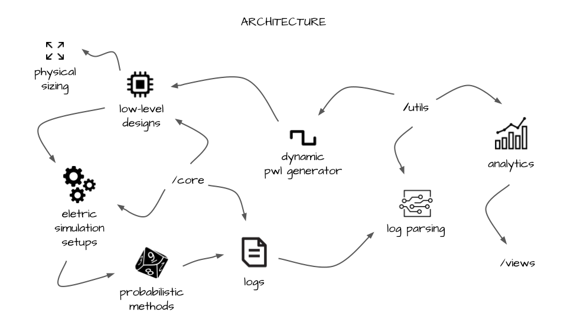

# adders aging

this repo consists on a remote env to centralize some hardware netlists and high-level utils related to my undergrad thesis on B.Sc computer engineering degree

text versioning is kept on another remote and will be appended at the end

the work is entitled 'Impact of charge trap kinetics on CMOS adder circuits' and aims to metrify the delays induced in circuit critical-signals by the contribution of eletric variability effects modeled by traps in cmos adders

## hierarchy
```
├─ /core                            -- arithmetic circuits under test
│  ├─ /carry-lookahead
│  │  ├─ /generators
│  │  ├─ /logic                            
│  │  └─ /logs
│  └─ /ripple-carry
├─ /models                          
├─ /scripts                      
├─ /utils                          
└─ /views                          
```

## architecture 

the workflow consists of:

i. low-level hardware designs drafted in 45nm

ii. synthesis of PWL sources an logic-gate duty factors for each interconnect using python

iii. electrical test from $10^{-7}$ to $10^7$ seconds under stress through montecarlo simulations

iv. estimation of collateral delay increase and power reduction using statistical approximations

v. log parsing and dataviz using data science basics

